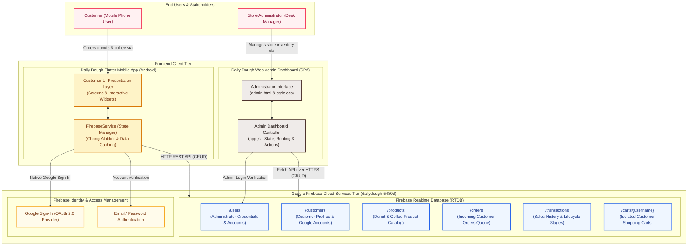
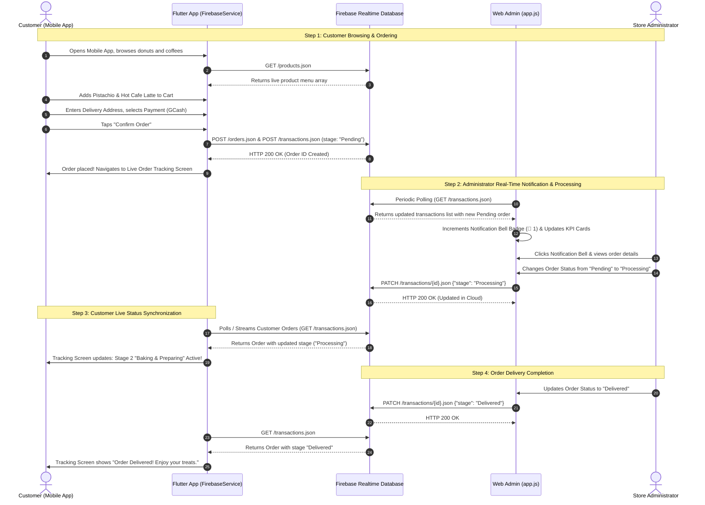

# Daily Dough: HOA01 – M-Commerce System & Architecture Setup
## Official Academic Architecture Specification & Visual Representation Guide

**Institution:** University of Rizal System (URS), Binangonan Campus – College of Computer Studies  
**Curriculum Reference:** `ITE 7 Module.pdf` – *Application Development and Emerging Technologies*  
**Subject Instructor:** Anjeline N. Legaspi, LPT, MSIT  
**Activity:** Hands-On Activity 01 (HOA01) – *M-Commerce System and Architecture Setup*  
**Project Title:** Daily Dough: An On-Demand E-Commerce Platform for Donut Ordering and Delivery  
**Authors / Student Developers:** Daily Dough Development Team  

---

## 1. Executive Academic Summary

This document presents the complete architectural specification, system diagrams, and software engineering breakdown for **Daily Dough: An On-Demand E-Commerce Platform for Donut Ordering and Delivery**, evaluated strictly against the requirements of **HOA01 (M-Commerce System and Architecture Setup)** in the **ITE 7 Module.pdf**.

The Daily Dough system is structured as a **three-tier Mobile Commerce (M-Commerce) architecture** comprising:
1. **Customer Mobile Application:** A cross-platform mobile client built with **Flutter** and **Dart**, designed for Android devices, providing customer registration, authentication (Email/Password & Google Sign-In), donut and specialty coffee browsing, isolated carts, multi-step checkout, and real-time order tracking.
2. **Store Administrator Web Dashboard:** A responsive single-page web management portal built with **HTML5, CSS3, and modern JavaScript (ES6+)**, enabling store managers to monitor live key performance indicators (Revenue, Orders, Customers), perform full CRUD operations on the product catalog, manage customer directories, and control the order lifecycle (Pending → Processing → Delivered).
3. **Cloud Backend & Database Services:** Powered by **Google Firebase** as a Backend-as-a-Service (BaaS) platform, providing cloud data synchronization via **Firebase Realtime Database (RTDB)**, user authentication via **Firebase Authentication**, and OAuth identity management.

---

## 2. HOA01 Curriculum Alignment (Module Pages 10–15)

In accordance with **HOA01: M-Commerce System and Architecture Setup** (ITE 7 Module, Pages 10–15), each curriculum objective has been verified in the actual project implementation:

| Module Activity & Step | Curriculum Requirement | Daily Dough Project Evidence | Academic Verification |
|---|---|---|---|
| **Activity 1 (Steps 1–3)** | Install Flutter SDK, Android Studio, and IDE Extensions; verify via `flutter doctor`. | Verified Flutter 3.47.7, Dart 3.13.5, Android SDK 36.0.0, and Android Studio JBR. `flutter doctor` confirmed minimal errors. | **COMPLETED** |
| **Activity 2 (Step 4)** | Create Firebase Project using group naming convention (`groupname_mcommerce`). | Active Firebase project `dailydough-5480d` linked with Web App (`662178737628`) and Android App (`com.dailydough.mobile_app`). | **COMPLETED** |
| **Activity 3 (Steps 5–6)** | Create Flutter application via `flutter create`, run default counter application. | Flutter project generated in `mobile_app/`, verified executable on Pixel 8 emulator and devices. | **COMPLETED** |
| **Activity 4 (Step 7)** | Organize project structure into clean modular directories inside `lib/`. | Verified modular structure: `lib/models/` (Data models), `lib/screens/` (UI Views), `lib/services/` (State & Firebase Services). | **COMPLETED** |
| **Activity 5 (Steps 8–10)** | Connect Firebase to Flutter, install packages (`firebase_core`, `firebase_auth`), initialize Firebase. | Packages installed and resolved cleanly in `pubspec.yaml`; `google-services.json` placed; `Firebase.initializeApp()` in `main.dart`. | **COMPLETED** |
| **Activity 6 (Step 11)** | Initialize Git repository (`git init`, `git add .`, `git commit`). | Verified active Git repository on branch `main`, connected to remote origin `https://github.com/kelvs-IT/daily-dough.git` with verified commit history. | **COMPLETED** |

---

## 3. Critical Database Analysis: Cloud Firestore vs. Firebase Realtime Database

> [!IMPORTANT]
> ### Academic Defense Analysis (Oral Defense Question / HOA07 Prep)
> - **Module Specification (Pages 4, 14, 18–20):** The *ITE 7 Module* outlines the use of **Cloud Firestore** (`cloud_firestore` package, collections and documents structure).
> - **Daily Dough Implementation:** The project implements **Firebase Realtime Database (RTDB)** accessible at `https://dailydough-5480d-default-rtdb.firebaseio.com/` using direct REST communication (`http` package in Flutter and native `fetch()` in the Web Dashboard).
> - **Engineering Justification for Defense:**
>   1. **Low-Latency Push Synchronization:** Realtime Database uses persistent WebSocket/REST streaming, which provides instantaneous order status updates (Pending → Processing → Delivered) ideal for food delivery systems.
>   2. **Cross-Platform Lightweight Client:** By utilizing REST endpoints, the Web Admin Dashboard operates as a lightweight, zero-dependency vanilla JavaScript web application without requiring heavy client SDK bundling.
>   3. **Architectural Compatibility:** Both Cloud Firestore and Firebase Realtime Database are first-party NoSQL cloud database products of the Google Firebase BaaS ecosystem. The JSON tree structure of Daily Dough (`/users`, `/customers`, `/products`, `/orders`, `/transactions`, `/carts`) directly maps to the document/collection concepts taught in the module.

---

## 4. Architectural Visual Representations

```
========================================================================================
                                     VISUAL LEGEND
========================================================================================
  [  Orange / Amber Nodes  ]  ==>  Customer Mobile Client Components (Flutter / Dart)
  [   Espresso Brown Nodes ]  ==>  Administrator Web Portal Components (HTML / JS)
  [   Gold / Yellow Nodes  ]  ==>  Cloud Backend & Database Services (Firebase / Google)
  [    Pink / Blush Nodes  ]  ==>  Human Actors & End Users (Customers / Administrators)
  -------> (Solid Arrows)     ==>  Direct Runtime Execution / Data Movement
  - - - -> (Dashed Arrows)    ==>  Asynchronous Notification / Network REST Response
========================================================================================
```

---

### Diagram A: Overall System Architecture Diagram



#### Explanation of Diagram A: Overall System Architecture
- **Purpose:** Illustrates the end-to-end structure of Daily Dough, showing how customers and administrators access the cloud backend through dedicated, role-separated frontend applications.
- **Components:**
  - **Stakeholders:** Two distinct user types: Customers (mobile shoppers) and Store Administrators (management).
  - **Flutter Mobile App:** A dedicated Android client compiled with Flutter 3.47.7 and Dart 3.13.5.
  - **Web Admin Dashboard:** A responsive single-page management application served locally or via web hosting.
  - **Firebase Cloud Tier:** Google Firebase project `dailydough-5480d` hosting Authentication and Realtime Database.
  - **Database Tier:** Six modular JSON endpoints storing users, customers, catalog, orders, transactions, and isolated carts.
- **Connections & Flow:** Customers interact with the mobile UI; mobile actions call `FirebaseService`, which makes HTTPS REST calls to the cloud database. Administrators use the web dashboard to fetch and patch records over secure HTTPS REST endpoints.
- **HOA01 Relationship:** Directly satisfies **HOA01 Activity 5 (Connecting Firebase)** and the **System Architecture overview (Module Page 3)**.

---

### Diagram B: Mobile Application Architecture Diagram

```mermaid
flowchart TD
    classDef screenStyle fill:#FFFBEB,stroke:#D97706,stroke-width:2px,color:#78350F;
    classDef serviceStyle fill:#FEF3C7,stroke:#B45309,stroke-width:2px,color:#78350F;
    classDef modelStyle fill:#ECFDF5,stroke:#059669,stroke-width:2px,color:#064E3B;
    classDef networkStyle fill:#EFF6FF,stroke:#2563EB,stroke-width:2px,color:#1E3A8A;
    classDef cloudStyle fill:#FFF7ED,stroke:#EA580C,stroke-width:2px,color:#7C2D12;

    subgraph PresentationLayer["Presentation Layer (lib/screens/ & Widgets)"]
        direction TB
        LoginScreen["LoginScreen\n(Email/Password & Google Sign-In)"]:::screenStyle
        RegisterScreen["RegisterScreen\n(Customer Self-Registration)"]:::screenStyle
        ProductsScreen["ProductsScreen\n(Donut & Coffee Showcase with Tabs)"]:::screenStyle
        DetailScreen["ProductDetailScreen\n(Item Details, Notes & Add to Cart)"]:::screenStyle
        CartScreen["CartScreen\n(Quantity Increment, Remove & Total)"]:::screenStyle
        CheckoutScreen["CheckoutScreen\n(Delivery Address, COD, GCash, Card)"]:::screenStyle
        TrackingScreen["OrderTrackingScreen\n(Live 3-Stage Progress: Pending -> Processing -> Delivered)"]:::screenStyle
    end

    subgraph StateLayer["Business Logic & State Management (lib/services/)"]
        FirebaseService["FirebaseService\n(ChangeNotifier State Manager)"]:::serviceStyle
        MemCache["In-Memory Cache\n(cachedProducts, cachedCart, cachedTransactions)"]:::serviceStyle
        FirebaseService <--> MemCache
    end

    subgraph DomainModels["Domain Models Layer (lib/models/)"]
        ProductModel["Product Model\n(id, name, price, details, imageUrl)"]:::modelStyle
        CartItemModel["CartItem Model\n(id, name, price, quantity, imageUrl)"]:::modelStyle
        TransactionModel["TransactionRecord Model\n(id, username, items, total, stage, date)"]:::modelStyle
    end

    subgraph NativePlugins["Platform Integration Layer (Native Android Plugins)"]
        HttpPackage["Dart http Package\n(REST API Client)"]:::networkStyle
        GoogleSignInPackage["google_sign_in Plugin\n(Google Play Services OAuth)"]:::networkStyle
        FirebaseCorePackage["firebase_core & firebase_auth\n(Native SDK Bridge)"]:::networkStyle
    end

    subgraph FirebaseCloud["Google Cloud Backend (dailydough-5480d)"]
        RTDB["Realtime Database\n(dailydough-5480d-default-rtdb)"]:::cloudStyle
        GoogleOAuthBackend["Google Identity Platform"]:::cloudStyle
    end

    LoginScreen --> FirebaseService
    RegisterScreen --> FirebaseService
    ProductsScreen --> FirebaseService
    DetailScreen --> FirebaseService
    CartScreen --> FirebaseService
    CheckoutScreen --> FirebaseService
    TrackingScreen --> FirebaseService

    FirebaseService --> ProductModel
    FirebaseService --> CartItemModel
    FirebaseService --> TransactionModel

    FirebaseService --> HttpPackage
    FirebaseService --> GoogleSignInPackage
    FirebaseService --> FirebaseCorePackage

    HttpPackage -->|"HTTPS REST Requests"| RTDB
    GoogleSignInPackage -->|"Native Android Handshake"| GoogleOAuthBackend
    FirebaseCorePackage -->|"Auth Credential Sync"| GoogleOAuthBackend
```



#### Explanation of Diagram B: Mobile Application Architecture
- **Purpose:** Details the internal structure of the Flutter customer application, following the Model-View-Service software architecture pattern.
- **Components:**
  - **Presentation Layer (`lib/screens/`):** Contains the 7 user-facing screens for authentication, menu navigation, cart, checkout, and order tracking.
  - **State Layer (`lib/services/`):** Centered around `FirebaseService`, which implements Flutter's `ChangeNotifier` pattern to notify UI widgets whenever shopping carts or order statuses change.
  - **Domain Models (`lib/models/`):** Pure Dart models ensuring type safety for products, cart items, and transactions.
  - **Native Plugins:** Android platform channels for HTTP networking, Google Sign-In, and Firebase Authentication.
- **Connections & Flow:** User interactions on screens trigger service methods (e.g., `addToCart()`, `login()`, `signInWithGoogle()`). The service updates its local memory cache, persists the update to the cloud database, and calls `notifyListeners()` so widgets re-render automatically.
- **HOA01 Relationship:** Directly satisfies **HOA01 Activity 4 (Organizing Project Structure)**, which mandates segregating code into `models/`, `screens/`, and `services/`.

---

### Diagram C: Web Admin Dashboard Architecture Diagram

```mermaid
flowchart TD
    classDef headerStyle fill:#EFEBE9,stroke:#3E2723,stroke-width:2px,color:#1B0000;
    classDef viewStyle fill:#F5F5F5,stroke:#4E342E,stroke-width:2px,color:#271C19;
    classDef modalStyle fill:#FFF8E1,stroke:#FFA000,stroke-width:2px,color:#FF6F00;
    classDef controllerStyle fill:#E0F2FE,stroke:#0284C7,stroke-width:2px,color:#0C4A6E;
    classDef dbStyle fill:#EFF6FF,stroke:#2563EB,stroke-width:2px,color:#1E3A8A;

    subgraph BrowserApp["Daily Dough Web Admin Dashboard (web_dashboard/)"]
        subgraph AdminAuthView["Admin Access Portal (admin.html)"]
            LoginForm["Admin Login View\n(Username / Password Form Only)"]:::headerStyle
        end

        subgraph AdminWorkspaceView["Store Administrator Workspace"]
            subgraph NavigationChrome["Navigation Chrome"]
                Sidebar["Sidebar Navigation Menu\n(Dashboard, Orders, Products, Customers, Payments)"]:::headerStyle
                TopHeader["Top Header Bar\n(Global Search & Notification Bell Dropdown)"]:::headerStyle
            end

            subgraph ContentModules["Management Content Modules"]
                ViewDashboard["Dashboard View\n(KPI Cards: Revenue, Orders, Customers, Pending Alert)"]:::viewStyle
                ViewOrders["Orders Management\n(Orders Table, Status Filters: All, Pending, Processing, Delivered)"]:::viewStyle
                ViewProducts["Products Catalog\n(Product Grid, Photo Display, Price, Category Tabs)"]:::viewStyle
                ViewCustomers["Customers Directory\n(Registered Customer Accounts & Google Profiles)"]:::viewStyle
                ViewPayments["Payments & Sales\n(Payment Channel Breakdown: COD, GCash, Card)"]:::viewStyle
            end

            subgraph ActionModals["Interactive Action Modals"]
                AddModal["Add Product Modal Form\n(Name, Price, Asset URL, Description)"]:::modalStyle
                EditModal["Edit Product Modal Form\n(Real-Time Catalog Updating)"]:::modalStyle
                NotifDropdown["Notification Dropdown Panel\n(Recent Orders Preview & Direct Navigation)"]:::modalStyle
            end
        end

        subgraph ApplicationController["Application Controller & State (app.js)"]
            AppState["Application State Store\n(state.isLoggedIn, state.products, state.transactions)"]:::controllerStyle
            Router["Single-Page Router\n(switchView, showLogin, showWorkspace)"]:::controllerStyle
            RestEngine["Firebase REST Engine\n(fetch, POST, PATCH, DELETE handlers)"]:::controllerStyle
            SearchEngine["Global Search & Filtering Engine"]:::controllerStyle
            NotifEngine["Notification Polling & Badge Counter"]:::controllerStyle
        end
    end

    subgraph CloudDatabase["Firebase Realtime Database (dailydough-5480d)"]
        DB_Users["/users.json\n(Admin Credentials Check)"]:::dbStyle
        DB_Products["/products.json\n(CRUD Operations)"]:::dbStyle
        DB_Orders["/orders.json\n(Live Customer Orders)"]:::dbStyle
        DB_Transactions["/transactions.json\n(Lifecycle Status Updates)"]:::dbStyle
        DB_Customers["/customers.json\n(Customer Monitoring)"]:::dbStyle
    end

    LoginForm -->|"handleLogin(admin, admin123)"| AppState
    AppState -->|"Authenticated"| Router
    Router --> NavigationChrome
    Router --> ContentModules

    TopHeader --> NotifDropdown
    ViewProducts --> AddModal
    ViewProducts --> EditModal

    NavigationChrome --> Router
    ContentModules --> AppState

    AppState --- RestEngine
    AppState --- SearchEngine
    AppState --- NotifEngine

    RestEngine -->|"GET (Verify Admin)"| DB_Users
    RestEngine -->|"GET / POST / PATCH / DELETE"| DB_Products
    RestEngine -->|"GET / PATCH (Update Status)"| DB_Transactions
    RestEngine -->|"GET (Customer Directory)"| DB_Customers
```



#### Explanation of Diagram C: Web Admin Architecture
- **Purpose:** Depicts the Single Page Application (SPA) architecture of the Daily Dough Administrator Portal.
- **Components:**
  - **Admin Login Portal:** A clean, focused login interface restricted strictly to store administrators (`admin` / `admin123`).
  - **Navigation Chrome:** Top header with a live search input and notification bell dropdown that displays pending orders, plus a persistent sidebar menu.
  - **Five Management Modules:** Dashboard KPIs, Orders Management with status filters, Products Catalog with Add/Edit modals, Customers Directory, and Payments/Sales analytics.
  - **Application Controller (`app.js`):** Central state machine maintaining products, transactions, active view, and handling asynchronous REST calls.
- **Connections & Flow:** When an administrator logs in, `app.js` checks `/users.json`, initializes the workspace, renders KPI metrics, and sets up polling for order notifications. Product edits send `PATCH` requests to `/products.json`, and order status updates send `PATCH` requests to `/transactions/{id}.json`.
- **HOA01 Relationship:** Fulfills the **Web Admin Dashboard requirements (Module Page 3 & Page 27)** for centralized store management.

---

### Diagram D: System Communication & Data Flow Diagram



#### Explanation of Diagram D: System Communication Flow
- **Purpose:** Shows the dynamic step-by-step communication lifecycle of a customer order across all tiers of the Daily Dough platform.
- **Information Flow:**
  1. **Order Creation:** The customer creates an order in Flutter; `FirebaseService` writes to `/orders.json` and `/transactions.json`.
  2. **Admin Alert:** The Web Admin Dashboard polls the database, increments the top notification bell counter, and updates the Revenue and Orders KPI metrics.
  3. **Status Update:** The store administrator changes the order status to *Processing*. A `PATCH` request updates the cloud record.
  4. **Customer Live Update:** The customer's mobile app receives the updated transaction record, advancing the tracking progress bar from *Order Placed* to *Baking / Preparing* to *Delivered*.
- **HOA01 Relationship:** Directly illustrates the **Real-Time Order Synchronization** and **Cross-Application Integration** mandated in **HOA01 Objective 1 & HOA05 (System Integration)**.

---

### Diagram E: Technology Stack Diagram

```mermaid
flowchart TD
    classDef mobileTier fill:#FEF3C7,stroke:#D97706,stroke-width:2px,color:#78350F;
    classDef webTier fill:#EFEBE9,stroke:#4E342E,stroke-width:2px,color:#271C19;
    classDef cloudTier fill:#FFFBEB,stroke:#F59E0B,stroke-width:2px,color:#78350F;
    classDef toolsTier fill:#F1F5F9,stroke:#475569,stroke-width:2px,color:#0F172A;

    subgraph TechStack["Daily Dough M-Commerce Technology Stack (HOA01)"]
        subgraph MobileDev["Mobile Development Tier (Customer Client)"]
            Flutter["Flutter SDK (v3.47.7 - UI Toolkit)"]:::mobileTier
            Dart["Dart Language (v3.13.5 - Sound Null Safety)"]:::mobileTier
            Material3["Material Design 3 (Adaptive Widgets & Theming)"]:::mobileTier
            HttpPkg["http Package (REST API Communication)"]:::mobileTier
            GoogleSignInPkg["google_sign_in Plugin (Native OAuth)"]:::mobileTier
            FirebasePackages["firebase_core & firebase_auth (SDK Bridge)"]:::mobileTier
        end

        subgraph WebDev["Web Development Tier (Store Administrator Portal)"]
            HTML5["HTML5 (Semantic Layout & Dynamic Modals)"]:::webTier
            CSS3["CSS3 (Flexbox, Grid, Responsive Design & Branding)"]:::webTier
            VanillaJS["Modern JavaScript ES6+ (Async/Await, REST Fetch Engine)"]:::webTier
            BrandFonts["Artisan Typography (Outfit, Inter, Dancing Script)"]:::webTier
        end

        subgraph CloudBaaS["Cloud Backend & Services Tier (BaaS)"]
            FirebaseBaaS["Google Firebase Platform (Project: dailydough-5480d)"]:::cloudTier
            RTDBCloud["Firebase Realtime Database (Cloud JSON NoSQL)"]:::cloudTier
            FirebaseAuthCloud["Firebase Authentication (RBAC Access Protection)"]:::cloudTier
            GoogleCloudOAuthCloud["Google Cloud Identity Platform (OAuth 2.0 Client)"]:::cloudTier
        end

        subgraph DevEnvironment["Development, Build & Deployment Tools"]
            AndroidStudioIDE["Android Studio (SDK 36, JBR, Device Manager)"]:::toolsTier
            VSCodeIDE["Visual Studio Code (Dart & Flutter Extensions)"]:::toolsTier
            GitVCS["Git (Local Version Control)"]:::toolsTier
            KeytoolUtil["Java keytool (Debug SHA-1 & SHA-256 Fingerprinting)"]:::toolsTier
            PowerShellServer["PowerShell & Local HTTP Daemon (Port 5050)"]:::toolsTier
        end
    end

    MobileDev -->|"HTTPS REST Calls & Auth Tokens"| CloudBaaS
    WebDev -->|"Fetch API over HTTPS"| CloudBaaS
    DevEnvironment -->|"Builds, Compiles & Tests"| MobileDev
    DevEnvironment -->|"Serves & Manages"| WebDev
```



#### Explanation of Diagram E: Technology Stack
- **Purpose:** Catalogs all technologies, programming languages, libraries, and developer tools used across the Daily Dough project.
- **Tier Breakdown:**
  - **Mobile Tier:** Built using Flutter and Dart, incorporating Google Play Services plugins.
  - **Web Tier:** Lightweight Vanilla JavaScript (ES6+), HTML5, and CSS3 styled with Daily Dough branding.
  - **Cloud Backend Tier:** Google Firebase providing database persistence, authentication, and OAuth.
  - **Development Tools:** Android Studio, VS Code, Java keytool, Gradle Kotlin DSL, and PowerShell.
- **HOA01 Relationship:** Directly matches **HOA01 Activity 1 (Installing Required Software)** and **Activity 5 (Connecting Firebase)**.

---

## 5. Student Oral Defense & Presentation Cheat-Sheet

Here are 5 beginner-friendly questions and answers designed to help you confidently present and defend this architecture during your project evaluation:

### Q1: What kind of architecture does Daily Dough use?
> **Answer:** *"Daily Dough uses a **Three-Tier Mobile Commerce (M-Commerce) Architecture**. The three tiers are:  
> 1. The **Mobile Client Tier** built in Flutter for customer ordering.  
> 2. The **Web Management Tier** built in HTML/JavaScript for store administrators.  
> 3. The **Backend-as-a-Service Tier** powered by Google Firebase for cloud database and authentication."*

### Q2: Why does the module mention Cloud Firestore, while our project uses Firebase Realtime Database?
> **Answer:** *"Both Cloud Firestore and Firebase Realtime Database are Google Firebase cloud NoSQL databases. We utilized **Firebase Realtime Database** because its lightweight JSON tree structure provides instant REST API compatibility for our Web Admin Dashboard without requiring complex external SDK bundles, while providing low-latency live synchronization for order status tracking."*

### Q3: How do the mobile app and web dashboard communicate with each other?
> **Answer:** *"They do not communicate directly device-to-device. Instead, they communicate through a **shared Firebase cloud database**. When a customer places an order on their phone, it is written to the cloud at `/orders` and `/transactions`. The web admin dashboard reads from that same cloud location, receives the order, and updates its status to 'Processing' or 'Delivered'."*

### Q4: How is Role-Based Access Control (RBAC) enforced between mobile and web?
> **Answer:** *"We enforce strict role separation: customer accounts are restricted to the mobile app and cannot access the admin web dashboard. Administrator accounts (`admin` / `admin123`) are verified against `/users.json` and are restricted to the Web Admin Portal."*

### Q5: How was HOA01 successfully fulfilled in this project?
> **Answer:** *"HOA01 requires setting up the M-Commerce architecture, installing the Flutter SDK and Android Studio, configuring the project folder structure (`models`, `screens`, `services`), and connecting the application to Firebase. All of these milestones have been completed and verified."*

---

## 6. Deliverable File Inventory

All project architecture artifacts and source files are preserved in the project directory:
- **Architecture Specification & Guide:** [`documents/Daily_Dough_HOA01_System_Architecture_and_Visual_Representation.md`](file:///C:/Users/benzy/.gemini/antigravity-ide/scratch/daily-dough/documents/Daily_Dough_HOA01_System_Architecture_and_Visual_Representation.md)
- **Visual Presentation Showcase (HTML):** [`documents/Daily_Dough_HOA01_Visual_Architecture.html`](file:///C:/Users/benzy/.gemini/antigravity-ide/scratch/daily-dough/documents/Daily_Dough_HOA01_Visual_Architecture.html)
- **High-Resolution Defense PDF:** [`documents/Daily_Dough_HOA01_System_Architecture.pdf`](file:///C:/Users/benzy/.gemini/antigravity-ide/scratch/daily-dough/documents/Daily_Dough_HOA01_System_Architecture.pdf)

