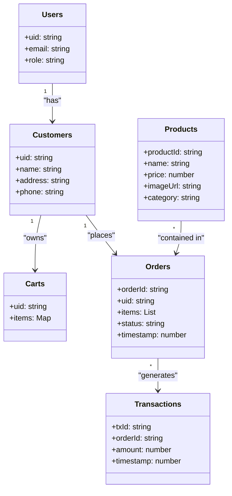

# Daily Dough Project Documentation

## 1. Introduction

**Daily Dough** is an on‑demand e‑commerce platform that enables customers to order donuts and coffee for delivery through a mobile application, while store owners manage inventory, orders, and sales via an admin web interface.

- **Purpose:** Provide a seamless, end‑to‑end ordering experience that integrates real‑time data synchronization using Firebase.
- **Problem Addressed:** Reduces friction in ordering fresh bakery items, eliminates phone‑order errors, and gives store staff a centralised dashboard for order fulfilment.
- **Intended Users:**
  - Customers who want to browse, purchase, and track donut/coffee orders.
  - Store administrators who manage products, view orders, and monitor payments.
- **System Overview:**
  - **Customer Mobile App** – Built with Flutter, authenticates via Firebase Authentication, and interacts with the Firebase Realtime Database for product, cart, and order data.
  - **Admin Web Application** – A lightweight HTML/JavaScript UI hosted locally, also using Firebase Authentication and the same Realtime Database for admin‑level operations.

## 2. Objectives

- **General Objective:** Deliver a reliable, real‑time e‑commerce solution for a bakery storefront.
- **Specific Objectives:**
  - Enable secure user registration and login.
  - Provide product browsing, cart management, and checkout flows.
  - Allow administrators to manage product listings and process orders.
  - Persist all data in Firebase with real‑time updates across platforms.
  - Maintain a clean, maintainable codebase using Flutter and vanilla JavaScript.

## 3. System Features

### Customer Mobile Application
- **Registration & Login** – Firebase Authentication (email/password).
- **Home Page** – Promotional carousel and quick links.
- **Product Browsing** – List of donuts and coffee items, populated from `/products`.
- **Shopping Cart** – Local cart synced to `/carts/{uid}`.
- **Checkout & Order Placement** – Writes order data to `/orders` and triggers payment flow.
- **Order Tracking** – Real‑time view of order status.
- **Customer Profile** – Edit personal details stored under `/customers/{uid}`.

### Admin Web Application
- **Admin Login** – Firebase Authentication (admin accounts).
- **Dashboard** – Overview of recent orders and sales metrics.
- **Product Listing & Management** – CRUD UI for `/products`.
- **Order Management** – View and update order status.
- **Customer Management** – List and edit customer records.
- **Payments & Sales** – Summary view of `/transactions` (no editing of records).

## 4. Technologies Used

| Technology | Role in Project |
|------------|-----------------|
| **Flutter** | Cross‑platform UI for the mobile app.
| **Dart** | Programming language for Flutter code.
| **Firebase Realtime Database** | Central data store for users, products, carts, orders, and transactions.
| **Firebase Authentication** | Secure login for both mobile and web admins.
| **HTML / CSS / JavaScript** | Front‑end stack for the admin web UI.
| **Visual Studio Code** | Primary editor for both codebases.
| **Android Studio** | Emulator and device testing for the Flutter app.
| **GitHub** | Source‑code version control.

## 5. Database Structure

- **/users** – Authentication records (managed by Firebase Auth).
- **/customers** – Profile information for each customer.
- **/products** – Catalog of donuts and coffee items.
- **/carts/{uid}** – Temporary cart contents per user.
- **/orders** – Order documents with status (`pending`, `preparing`, `delivered`).
- **/transactions** – Payment records created after successful checkout.

No additional nodes (e.g., inventory) are present.

## 6. Workflow

### Customer Workflow
1. **Register / Login** – Firebase Auth creates a UID.
2. **Browse Products** – UI fetches `/products`.
3. **Add to Cart** – Updates `/carts/{uid}` in real‑time.
4. **Checkout** – Order data written to `/orders`; payment processed and stored in `/transactions`.
5. **Track Order** – Order status listener on `/orders/{orderId}` updates UI.

### Admin Workflow
1. **Admin Login** – Authenticates as an admin user.
2. **Dashboard** – Reads summary nodes (orders, transactions).
3. **Product Management** – CRUD operations on `/products`.
4. **Order Management** – Views `/orders`, updates status field.
5. **Payments & Sales** – Reads `/transactions` for reporting.

Firebase’s real‑time listeners keep both apps instantly synchronized.

## 7. Challenges Encountered

- **Firebase Security Rules** – Needed careful rule design to allow customers read/write only to their own cart and orders while preventing cross‑user access.
- **Data Synchronisation** – Ensuring the mobile cart updates instantly on multiple devices required robust listener handling.
- **Authentication Flow** – Managing token refresh and session persistence in Flutter introduced edge‑case bugs that were solved by integrating `firebase_auth`’s latest SDK.
- **Admin UI Consistency** – Removing the legacy *System Settings* page without breaking navigation required updating routing tables and cleaning up unused components.
- **Testing** – Real‑time database mocks were required for unit tests; configuring the test harness was non‑trivial.

## 8. Conclusion

Daily Dough successfully delivers an end‑to‑end ordering experience for a boutique bakery. Customers benefit from a smooth mobile UI to browse, purchase, and track donuts and coffee, while administrators gain a concise web dashboard for product and order management. Leveraging Firebase’s real‑time capabilities ensures data consistency across platforms, making the system robust and scalable for future feature expansion.

